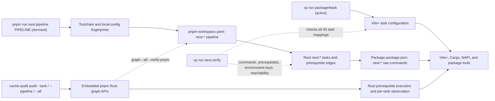
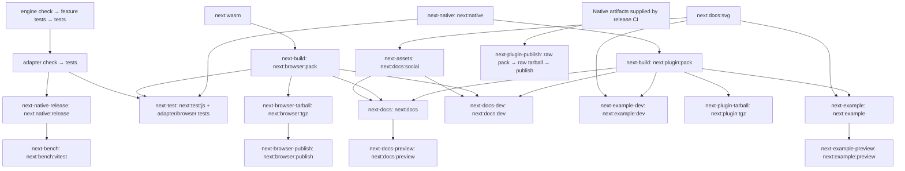

# Contributing

Thanks for contributing to `vite-svg-2-webfont`.

## Development Setup

This repository uses:

- The Node version pinned in [`.node-version`](./.node-version)
- Vite+ through the `vp` CLI for installs, checks, tests, builds, and task execution. See the [Vite+ docs](https://viteplus.dev/guide/) for more information about the toolchain and workflow, and how to install it.
- `pnpm` underneath the hood as the package manager, managed through `vp`
- `oxlint` for linting, type-aware checks, and type checking through Vite+ and `tsgo`
- `oxfmt` for formatting through Vite+
- A monorepo workspace with JavaScript packages under `packages/` and the Rust engine under `crates/`
- Stable Rust with Cargo, Clippy, and rustfmt for the native generator. The JavaScript test and plugin build tasks build this native binding automatically.

Install Rust before running the full dependency install. pnpm materializes the locked Cargo
dependencies as well as JavaScript dependencies.

Install dependencies from the repository root:

```bash
vp install
vp exec playwright install chromium firefox webkit
```

On Linux, use `vp exec playwright install --with-deps chromium firefox webkit` to install browser system dependencies as well. Rerun `vp install` after pulling dependency changes.

## Common Commands

Run these from the repository root:

```bash
vp check                                         # format, lint, TypeScript checks
vp run test                                      # JavaScript, browser, and type tests; builds native and WASM bindings
vp run coverage                                  # non-browser JavaScript tests with coverage
vp run coverage:scripts                          # repository script tests, including subprocess coverage
vp run bench:vitest                              # Vitest benchmarks with release binding and per-test results
vp run vite-svg-2-webfont#pack                   # build the Vite plugin
vp run @atlowchemi/webfont-generator#build       # build the native addon
vp run @atlowchemi/webfont-generator#check       # Clippy (default, CLI, NAPI) and rustfmt checks
vp run @atlowchemi/webfont-generator#test        # Rust checks and tests
vp run @atlowchemi/webfont-browser-generator#test # WASM adapter: build, check, browsers and production bundle
vp run @atlowchemi/webfont-browser-generator#pack:tgz # installable JS/types/worker/WASM tarball
vp run @atlowchemi/webfont-browser-generator#test:coverage # JS/worker and actual WASM Rust coverage
vp run @atlowchemi/webfont-generator#bench       # run Rust Criterion benchmarks
vp run @atlowchemi/vite-svg-webfont-docs#dev     # docs dev server
vp run @atlowchemi/vite-svg-webfont-docs#build   # build docs
vp run @atlowchemi/vite-svg-webfont-example#dev    # run example app
```

Run tasks that build or restore the native binding sequentially within a checkout.
For example, `vp run test` and `vp run vite-svg-2-webfont#pack` both use the same
generated binding files; separate invocations should not write them concurrently.

### Dormant pnpm task graph

Normal development still uses the `vp` commands above. The `next:*` scripts and
`next-*` pipelines are the replacement graph under validation, not the active
workflow. Task coverage is complete; cache readiness is still being validated.



The main artifact dependencies below apply to both graphs. Arrows point from a
prerequisite to its consumer. Pipeline names label the dormant entry points;
task names appear inside their nodes.



The inventory covers every task in the existing `vite.config.ts` files:

| Owner                                   | Existing tasks (use `vp run owner#task`)                                                                                                              | Dormant pipeline entry points                                                                                                                                                                                         |
| --------------------------------------- | ----------------------------------------------------------------------------------------------------------------------------------------------------- | --------------------------------------------------------------------------------------------------------------------------------------------------------------------------------------------------------------------- |
| Root (omit `owner#`)                    | `test`, `test:compat`, `coverage`, `coverage:scripts`, `bench:vitest`                                                                                 | `next-test`, `next-compat`, `next-coverage`, `next-scripts-coverage`, `next-bench`                                                                                                                                    |
| `@atlowchemi/webfont-engine`            | `check`, `test`, `test:features`, `bench`, `test:coverage`, `test:coverage:cli`, `test:doctests`, `test:color-proof`                                  | `next-check` / `next-test` include checks and feature tests; `next-engine-bench`, `next-engine-coverage`, `next-cli-coverage`, `next-doctests`, `next-engine-color-proof`                                             |
| `@atlowchemi/webfont-generator`         | `check`, `test`, `build`, `build:release`, `bench`, `test:browser`, `test:color-proof`, `test:coverage`, `test:coverage:native`, `binding:regenerate` | `next-check`, `next-test`, `next-native`, `next-native-release`, `next-adapter-bench`, `next-adapter-browser`, `next-adapter-color-proof`, `next-adapter-coverage`, `next-native-coverage`, `next-binding-regenerate` |
| `@atlowchemi/webfont-browser-generator` | `build`, `pack`, `check`, `test`, `pack:tgz`, `test:coverage`, `publish`                                                                              | `next-build` includes WASM and pack; `next-check`, `next-test`, `next-browser-tarball`, `next-browser-coverage`, `next-browser-publish`                                                                               |
| `vite-svg-2-webfont`                    | `dev`, `pack`, `pack:tgz`, `test`, `test:browser`, `test:fixtures:refresh`, `publish`                                                                 | `next-plugin-dev`, `next-build`, `next-plugin-tarball`, `next-plugin-test`, `next-plugin-browser`, `next-fixtures-refresh`, `next-plugin-publish`                                                                     |
| `@atlowchemi/vite-svg-webfont-example`  | `dev`, `build`, `preview`                                                                                                                             | `next-example-dev`, `next-example`, `next-example-preview`                                                                                                                                                            |
| `@atlowchemi/vite-svg-webfont-docs`     | `optimize-svg`, `social-card`, `dev`, `build`, `preview`                                                                                              | `next-assets` includes SVG and social cards; `next-docs-dev`, `next-docs`, `next-docs-preview`                                                                                                                        |

The package-local `next:TASK` script contains the raw command. Root aliases such
as `next:native` and `next:wasm` own cross-package cache declarations. Use the
pipeline launcher to prepare prerequisites and compute environment fingerprints;
calling a raw package script does neither.

Lifecycle hooks (`prepare`, native `prepublishOnly`) retain their existing names
and automatic package-manager behavior. The auditor's own commands are exposed
through `vp run @atlowchemi/cache-audit#TASK`; see its
[README](./crates/cache-audit/README.md).

The Linux auditor owns graph selection, serial prerequisite execution, per-task
reports, cancellation, and temporary Cargo targets in Rust. Its `--all` selects
reviewed policy tasks; it does not launch dev servers or publish pipelines.
`test:compat` validates cache behavior in a temporary fixture with separate pnpm
caches; `audit:negative` mutates a temporary workspace copy. The package's Node
entry point only forwards arguments and signals to the compiled binary.

`vp run next:verify` discovers all configured tasks and checks command/dependency
parity, environment inputs, and pipeline reachability. `--run` executes a finite
validation suite including builds, tests, coverage, and tarballs. Dev/preview,
publishing, benchmarks, fixture regeneration, and specialized coverage commands
are invoked explicitly, not automatically by that suite. Rust formatting is a
separate `next:fmt:rust` pipeline task to keep engine-only cache dependencies narrow.

### Build caches and generated files

Dependency caches, Cargo build outputs, and Vite+ task outputs serve different purposes:

- `vp install` reuses downloaded dependencies; this does not mean a build or test ran.
- Cargo reuses compiled work under the workspace `target/` directory.
- Vite+ task-cache hits restore task outputs and replay logs. The native build caches
  the platform `.node` file and `binding.js` / `binding.d.ts`; the plugin pack task
  produces its `dist/` bundle and declarations.

Use `vp run --no-cache <package>#<task>` when you need the task to execute rather than
restore its result. This bypasses Vite+ task caching, not Cargo's compilation cache or
the dependency store. It is not a cold-build measurement.

Let the native build regenerate bindings rather than editing them manually. Include
generated binding changes with the source changes that produced them.

### Running coverage locally

`vp run coverage` measures non-browser JavaScript coverage. To measure Rust code,
including Rust executed through the Node addon, install these additional tools:

```bash
rustup component add llvm-tools-preview
cargo install cargo-llvm-cov --locked
cargo install cargo-nextest --locked
```

Run the relevant tasks from the repository root (native coverage requires Linux or macOS with Bash):

```bash
vp run @atlowchemi/webfont-engine#test:coverage          # engine library and integration tests
vp run @atlowchemi/webfont-engine#test:coverage:cli      # binary tests and CLI-only integration tests
vp run @atlowchemi/webfont-generator#test:coverage       # native adapter Rust tests
vp run @atlowchemi/webfont-generator#test:coverage:native # adapter Vitest tests: Rust + JS coverage
vp run @atlowchemi/webfont-engine#test:doctests           # default and CLI-feature Cargo doctests
```

The Rust tasks write `rust.lcov` and `junit.xml` under `coverage/rust-engine/`,
`coverage/rust-cli/`, and `coverage/rust-adapter/`. Native Vitest coverage writes
`rust.lcov`, `js/lcov.info`, and `junit.xml` under `coverage/napi-vitest/`.
Run root JavaScript coverage first if collecting all reports locally: it cleans
the root `coverage/` directory.

`vp run coverage:scripts` runs the `scripts` Vite test project and writes
`coverage/scripts/lcov.info`. It enables V8 subprocess coverage for scripts launched
by the tests. CI runs this project when `scripts/` changes, with its own Codecov flag
and test-results report. Shell scripts are outside V8's JavaScript/TypeScript coverage.

Coverage executions are uncached and use isolated instrumented builds. Their temporary
run directories are removed on exit, including failures; exported reports remain.
Directories left by older task versions or forcibly terminated processes can be removed
from `coverage/*/run.*` after confirming no coverage tasks are running.

Nextest produces individual Rust test results but does not run doctests. The doctest
task uses Cargo and writes two aggregate invocation results to `test-results/doctests.xml`.
It requires Rust but does not require the coverage tools above.

### Regenerating test fixtures

After adding, removing, or modifying SVG icons in the plugin's fixture directory (`packages/vite-svg-2-webfont/src/fixtures/webfont-test/svg/`), regenerate the expected font fixtures:

```bash
vp run vite-svg-2-webfont#test:fixtures:refresh
```

### Benchmarks

The repository has two benchmark layers:

- Rust Criterion benchmarks in `crates/webfont-generator/benches/` isolate native generator internals, pipeline stages, incremental regeneration, output formats, templates, write paths, and scaling behavior.
- Vitest benchmarks in `tests/webfonts-generator.bench.ts` exercise the JavaScript-facing API and compare against upstream behavior through the Node/NAPI boundary.

Run Rust benchmarks through the package Vite+ task:

```bash
vp run @atlowchemi/webfont-generator#bench
```

Use compile-only validation while editing benchmark targets or benchmark-only support code:

```bash
vp run @atlowchemi/webfont-generator#bench --no-run
```

Run targeted Criterion filters when investigating a specific path, for example:

```bash
vp run @atlowchemi/webfont-generator#bench --bench pipeline -- pipeline_stages/woff2_output_only/300
```

Run JavaScript-facing Vitest benchmarks with:

```bash
vp run bench:vitest
```

This task builds the optimized release binding, including its existing Rust check/test dependencies, and runs the benchmarks once with fresh measurements. The verbose reporter prints each comparison and its results as it completes. Skipped comparisons are hidden when filtering; individual iterations within a running comparison are not printed.

For a focused comparison, use Vitest's long-form filter flag (`-t` is a Vite+ task-runner option):

```bash
vp run bench:vitest --testNamePattern='batched vs separate content edits — 600 glyphs'
```

Use this task when collecting timings: `vp run test` builds a debug binding, which can make expensive benchmarks exceed their timeout. The benchmark task rebuilds the release binding before measuring. Vitest v5 sampling defaults apply except where a scenario specifies its own options; a sampling time is a minimum measurement window, not a maximum runtime.

Benchmark CI also uses verbose reporting and writes a JSON report for historical comparisons.

The Rust benchmarks prefer Iconify JSON fixtures from the workspace `node_modules` when available and fall back to deterministic synthetic SVGs. Keep this fallback so `cargo bench` still works after a clean Rust-only checkout, but use `vp install` first when collecting numbers intended for comparison.

## Tools

- `vp` is the entry point for the development workflow in this repository.
- `oxlint` is the main linting tool and is run through `vp lint` and `vp check`.
- `oxlint` is configured for type-aware linting and type checking through Vite+, powered by `tsgo`.
- `oxfmt` is the formatter and is run through `vp fmt` and `vp check`.
- `vitest` is used for unit tests and is run through `vp test`.

## Project Structure

This monorepo has a root Cargo workspace and the following packages:

- `packages/vite-svg-2-webfont/`: the Vite plugin — source code, tests, and build config
- `crates/webfont-generator/`: published Rust engine and CLI; its private npm manifest connects the task graph
- `packages/webfont-generator/`: `@atlowchemi/webfont-generator` — npm API and unpublished `webfont-generator-napi` adapter crate
- `packages/webfont-browser/`: browser npm package with precompiled WASM and an unpublished wasm-bindgen adapter crate
- `packages/example/`: Vite app used for local development and manual verification
- `packages/docs/`: VitePress documentation site, published to GitHub Pages
- `tests/`: cross-package compatibility tests and benchmarks (at root level)

Cargo uses the root `Cargo.lock` and `target/`. Templates are tracked solely under
`packages/webfont-generator/templates/` and ship directly in the npm package. Adapter tests
verify shipped-template parity through the generation API. Engine tests use engine-owned
SVG fixtures and small custom-template inputs, without reading downstream package assets.
The library and CLI do not need the npm templates for default rendering.
Release Please links engine/adapter versions. The engine uses the Rust release strategy;
its private npm manifest uses the fixed placeholder version `0.0.0-internal-only` for workspace packaging and task-graph discovery, not Rust releases. The engine has its own changelog at
`crates/webfont-generator/CHANGELOG.md` and GitHub releases tagged `webfont-engine-v*`;
those releases trigger crates.io publication. The npm adapter retains its own changelog
and `webfont-generator-v*` releases. npm/crates.io identities are unchanged, and the
engine's private npm task package is never published.

The browser build uses `wasm32-unknown-unknown` and installs a matching wasm-bindgen CLI
under `target/wasm-bindgen-tools`; Rust/rustup are prerequisites. `WASM_BINDGEN` can select
an existing CLI of the exact required version. WASM generation uses only the engine's
`in_memory` feature. `#build` compiles the WASM binding; `#pack` builds the complete `dist/`
distribution, and `#pack:tgz` creates an installable tarball. Workspace consumers must run
`#pack` first. See the [browser API documentation](https://atlowChemi.github.io/vite-svg-2-webfont/webfont-generator/browser) for usage and worker ownership.

Browser coverage writes `coverage/browser-js/lcov.info` and `coverage/browser-rust/lcov.info`.
JavaScript coverage combines Chromium client tests with worker protocol tests running real WASM
in Node, replacing only message transport and asset fetching. Rust coverage runs the adapter's
WASM tests through wasm-bindgen-test in Node. It requires `cargo-llvm-cov` 0.9.0+, a WASM-capable
`clang` on PATH, and this coverage-only toolchain:

```sh
rustup toolchain install nightly-2026-02-18 --profile minimal --component llvm-tools-preview --target wasm32-unknown-unknown
```

On macOS, put Homebrew LLVM's `bin` directory on PATH; Apple clang lacks the WASM target.
`WEBFONT_COVERAGE_TOOLCHAIN` overrides the coverage toolchain; normal builds use stable Rust.
The pinned nightly uses LLVM 22 to match wasm-bindgen-test's exact minicov 0.3.8 dependency.
CI uploads coverage with the `browser-js` and `browser-rust` flags and reports the production
smoke app's JS, worker and WASM assets as Codecov bundle `webfont-browser-generator-bundle`.

Release-PR preparation updates Cargo.lock through the registry before frozen installation, runs
`vp run @atlowchemi/webfont-generator#binding:regenerate`, and formats changes with `vp fmt`.
The regeneration task uses the NAPI generator to update only the JS loader, preserving
exports from the last full binding build without compiling Rust. Changes to the native API
still require the normal binding build to refresh both exports and TypeScript declarations.

## Pull Requests

### How CI selects validation

CI always runs shared lint/checks and an affected-selection job. The selector asks pnpm
for changed workspace packages and their dependents, then chooses the validation jobs
and native artifacts those jobs need. The `affected-selection` artifact and job summary
record the comparison base, changed files, packages, decisions, and reason.

- Pull requests compare the checked-out PR head with its merge-base against the target
  SHA in the event. Pushes to `main` compare against the previous branch tip and also
  use affected selection.
- Root/shared files, including lockfiles, select all packages. Package-local manifests
  follow normal package/dependent selection. The three package changelogs additionally
  select docs because the site includes them.
- Unavailable history or an invalid package query falls back to full validation;
  rewritten push history does too. Changed files with an empty or root-only package
  selection also broaden validation. An unknown package name fails selection: update
  the selector's package/job mapping when adding a workspace package.

| Affected package   | Direct Rust suites   | Native build artifacts | Other selected validation                                                      |
| ------------------ | -------------------- | ---------------------- | ------------------------------------------------------------------------------ |
| Engine / CLI       | Engine, CLI, adapter | All nine targets       | Native Vitest, host/musl, Node/Vite, browser, WASM                             |
| npm / NAPI adapter | Adapter              | All nine targets       | Native Vitest, host/musl, Node/Vite, browser                                   |
| Plugin / example   | None                 | Linux x64 GNU          | Node/Vite, browser                                                             |
| Browser workspace  | WASM Clippy          | None                   | Actual WASM generation in Chromium/Firefox/WebKit and production worker bundle |
| Docs               | None                 | None                   | Docs build                                                                     |

Adapter tests still compile/use the engine as a dependency; skipping its direct test
suite does not remove that dependency. Native Vitest coverage also measures engine
execution through the addon. Repository script tests run separately when `scripts/`
changes, or conservatively when comparison is unavailable; they do not run merely
because all packages were selected.

`Required checks` validates the selection and every expected result. Unexpected skips,
failures, cancellations, or missing native prerequisites fail the aggregate with GitHub
error annotations. Selected coverage jobs must produce nonempty reports and upload
successfully before Codecov finalization. Intentionally absent flags carry forward
previous coverage; changes needing no coverage use `empty-upload`. Carried coverage
is historical evidence, not a claim that skipped tests ran on the new commit.

### Choosing local checks

Before opening a pull request, please:

1. Install dependencies with `vp install`.
2. Build the plugin with `vp run vite-svg-2-webfont#pack`.
3. Run `vp check` for formatting, lint, and TypeScript checks.
4. Run `vp run test` when your change affects JavaScript or browser behavior; use `vp run coverage` to check non-browser JavaScript coverage.
5. Run `vp run @atlowchemi/webfont-generator#test` when changing Rust code; this includes Rust checks and tests. The root JavaScript test task does not run the Rust test suite.
6. Run `vp run @atlowchemi/webfont-generator#bench --no-run` when changing Rust benchmark targets or benchmark-only support code.
7. Run targeted Rust or Vitest benchmark filters when changing measured performance behavior.
8. Verify the example app with `vp run @atlowchemi/vite-svg-webfont-example#dev` or `vp run @atlowchemi/vite-svg-webfont-example#build` for user-facing changes.
9. Verify the docs site with `vp run @atlowchemi/vite-svg-webfont-docs#build` when you change site documentation or docs config.

## Releasing packages

The [release workflow](./.github/workflows/release.yaml) runs on pushes to `main`.
Release Please selects versions and releases using
[`release-please-config.json`](./release-please-config.json); affected CI decisions
do not select packages for publication.

| Release Please output   | Publication work                                                                                                             |
| ----------------------- | ---------------------------------------------------------------------------------------------------------------------------- |
| Engine release created  | Publish `webfont-generator` to crates.io                                                                                     |
| Adapter release created | Build all nine native targets, stage platform npm packages and `@atlowchemi/webfont-generator`, upload native release assets |
| Plugin release created  | Bundle the plugin, create its tarball, stage `vite-svg-2-webfont`, upload the tarball                                        |

Engine and adapter versions are linked by Release Please, so a release may select both.
Each publication job still requires its own package's `release_created` output.
Any created release also triggers docs deployment.

The plugin's `publish` task is release-only: it explicitly runs `pack` and `pack:tgz`
with `--ignore-depends-on` before staging the tarball. Its dependencies remain external,
so this path neither compiles Rust nor consumes native release-matrix artifacts. The
normal development `pack` task retains its native build prerequisite.

To complete a release:

1. Review the Release Please PR, including linked engine/adapter versions, changelogs,
   lockfiles, and generated loader updates described in [Project Structure](#project-structure).
2. Merge it after its selected checks pass, then inspect the release workflow's package-specific jobs.
3. For npm releases, use the staging IDs in the workflow summary. Approve with
   `pnpm stage approve <id> --otp <code>` from a 2FA-enrolled maintainer machine;
   approve platform packages before their adapter package. A successful staging job
   alone is not proof that a package is publicly available.
4. Confirm the intended versions are available in npm/crates.io and that GitHub release
   assets match the selected releases. Verify installation from the registry, rather
   than from workspace links.

## Commit Conventions

This project uses [Conventional Commits](https://www.conventionalcommits.org/) format for commit messages and PR titles. This is required for automated changelog generation via release-please.

The format is:

```
type(scope): description
```

Common types:

- `feat` - A new feature
- `fix` - A bug fix
- `chore` - Maintenance tasks, dependency updates
- `docs` - Documentation changes
- `refactor` - Code restructuring without behavior changes
- `test` - Adding or updating tests
- `ci` - CI/CD configuration changes
- `perf` - Performance improvements

Examples:

```
feat: add support for custom font formats
fix(vite-svg-2-webfont): handle empty SVG directory gracefully
docs: update configuration reference
chore: bump dependencies
```

Scopes are optional; when used, they must match `scope-enum` in [`commitlint.config.js`](./commitlint.config.js). The `commit-msg` hook validates commit messages, and CI validates PR titles. You can validate either before submitting:

```bash
printf '%s\n' 'chore(benchmarks): show per-test progress locally and in CI' | vp exec commitlint
```

## Before You Commit

Commits should be created only after the code passes the repository checks.

The checked-in hooks in `.vite-hooks/` run:

- `pre-commit`: `vp staged`, then `vp test`. Staged-file tasks run `vp check --fix` and Rust formatting as configured in the root `vite.config.ts`.
- `commit-msg`: `vp exec commitlint --edit` to validate the message.

`vp install` invokes `vp config` to set up hooks. If Git already has a custom `core.hooksPath`, Vite+ may leave it in place; check your local hook configuration rather than assuming these hooks are active.

Run `vp run test` before committing to ensure the native binding is built. The hook's direct `vp test` command does not build it or run the Rust test suite, and hooks do not replace the change-specific checks above.

## Notes

- Keep lockfile changes in `pnpm-lock.yaml` when dependencies change.
- Do not commit `package-lock.json` files to the workspace.
- Use `vp` instead of calling `pnpm`, `vite`, `vitest`, `oxlint`, or `oxfmt` directly for normal repository workflows.
- The docs site is driven by Vite+ run tasks in `packages/docs/`, so prefer `vp run @atlowchemi/vite-svg-webfont-docs#dev` over direct `vitepress` commands.
