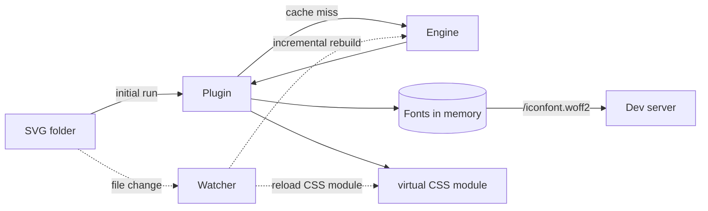
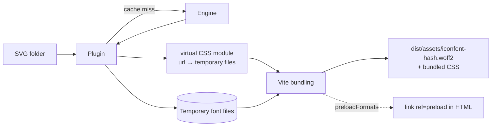

# How It Works

This page describes what the plugin does inside Vite: when it generates fonts, where they go, and how options change that. Font generation itself is handled by the [webfont generator engine](/webfont-generator/). The plugin calls it whenever fonts need to be built or rebuilt.

## Overview

When Vite starts, in either development or build, the plugin:

1. **Resolves your options** and finds the SVG files matching [`files`](/configuration#files) (or each design's files in [`variants`](/configuration#variants)) inside [`context`](/configuration#context).
2. **Checks the [output cache](#output-cache).** If nothing changed since the last run, it reuses the stored fonts and CSS instead of calling the engine.
3. **Otherwise calls the engine** to generate every format listed in [`types`](/configuration#types), and stores the result in the cache for next time. The engine keeps its own [persistent cache](#engine-cache), so unchanged icons and formats are reused even then.
4. **Exposes the CSS** through the virtual module, `virtual:vite-svg-2-webfont.css` by default (see [`moduleId`](/configuration#moduleid)). Importing it brings the `@font-face` rule and icon classes into your app.

What happens next depends on whether you are running the dev server or a production build.

## Development



- **Fonts stay in memory.** The dev server serves each format at `/<fontName>.<type>`, for example `/iconfont.woff2`, and the virtual CSS points at those URLs. Nothing is written to disk unless you enable [`generateFiles`](/configuration#generatefiles).
- **SVG changes update the page without a full reload.** The plugin watches your icon folders. When an SVG is added, changed, or removed, it rebuilds the font and reloads the virtual CSS module through Vite's HMR, so icons update in place.
- **Rebuilds are incremental.** In development the plugin asks the engine to keep its work between builds, so a rebuild only reprocesses the icons that changed. It falls back to a full rebuild if an incremental one fails.
- **Rebuilds are fast by default.** In development WOFF2 uses Brotli quality `10` instead of `11`: the font renders identically, its bytes are a little larger, and encoding is about twice as fast. Set [`woff2CompressionQuality`](/configuration#woff2compressionquality) to pin one value for both.
- **Edits are serialized.** Changes that arrive close together (within about 25 ms) are batched into one rebuild, and rebuilds run one at a time in order. If an edit produces invalid input, the plugin reports a warning and keeps serving the last good font until a later change succeeds.

### What the watcher sees

| Setup                                                      | Watched                                                                       |
| ---------------------------------------------------------- | ----------------------------------------------------------------------------- |
| Single design with flat globs, such as the default `*.svg` | The `context` folder itself                                                   |
| Single design with nested globs, such as `**/*.svg`        | The `context` folder recursively, including subfolders created while running  |
| Multi-weight (`variants`)                                  | Each design's folder, recursively, including subfolders created while running |

Only `.svg` files trigger rebuilds. In recursively watched folders, SVGs that your globs don't match are ignored. Changes to a custom [`cssTemplate`](/configuration#csstemplate) or [`htmlTemplate`](/configuration#htmltemplate) and to `vite.config.ts` itself need a dev server restart.

## Build



- **Fonts become ordinary Vite assets.** The plugin writes the fonts to a temporary folder and points the virtual CSS at them. Vite then processes the fonts like any other asset referenced from CSS: hashed file names, [`build.assetsDir`](https://vite.dev/config/build-options.html#build-assetsdir), [`base`](https://vite.dev/config/shared-options.html#base), and `assetFileNames` all apply. See [production font output](/usage#configure-production-font-output).
- **Vite's `assetsInlineLimit` still applies.** Small fonts may be embedded as data URLs unless you set `build.assetsInlineLimit: 0`.
- **Preload tags are added to built HTML.** With [`preloadFormats`](/configuration#preloadformats), the plugin adds `<link rel="preload" as="font" crossorigin>` for the emitted fonts, filtered by [`shouldProcessHtml`](/configuration#shouldprocesshtml).
- **The plugin writes no files of its own** unless you enable both [`generateFiles`](/configuration#generatefiles) and [`allowWriteFilesInBuild`](/configuration#allowwritefilesinbuild). Those files are extra copies; Vite's bundled assets are unaffected.
- **Other plugins can read the emitted font URLs** through the [public API](/public-api).
- **WOFF2 uses Brotli quality `11`** (the smallest output) unless you set [`woff2CompressionQuality`](/configuration#woff2compressionquality).

## How options change the flow

| Option                                                              | Development                                                                                              | Build                                                                                                                                       |
| ------------------------------------------------------------------- | -------------------------------------------------------------------------------------------------------- | ------------------------------------------------------------------------------------------------------------------------------------------- |
| [`inline`](/configuration#inline)                                   | Fonts are embedded in the CSS as base64; no font URLs are served                                         | Fonts are embedded in the CSS; no font assets or preload tags                                                                               |
| [`generateFiles`](/configuration#generatefiles)                     | Writes the selected files (CSS, HTML, fonts) to disk, rewriting CSS/HTML only when their content changes | Ignored unless `allowWriteFilesInBuild` is set                                                                                              |
| [`allowWriteFilesInBuild`](/configuration#allowwritefilesinbuild)   | —                                                                                                        | Lets `generateFiles` write to [`dest`](/configuration#dest), [`cssDest`](/configuration#cssdest), and [`htmlDest`](/configuration#htmldest) |
| [`preloadFormats`](/configuration#preloadformats)                   | —                                                                                                        | Adds preload tags to built HTML (not with `inline`)                                                                                         |
| [`cssContext`](/configuration#csscontext)                           | Turns off incremental rebuilds (every change is a full rebuild) and the output cache                     | Turns off the output cache                                                                                                                  |
| [`woff2CompressionQuality`](/configuration#woff2compressionquality) | Defaults to `10` when unset                                                                              | Defaults to `11` when unset                                                                                                                 |
| [`cssFontsUrl`](/configuration#cssfontsurl)                         | Affects files written by `generateFiles`                                                                 | Affects files written by `generateFiles`; bundled CSS URLs come from Vite                                                                   |
| [`moduleId`](/configuration#moduleid)                               | Name of the virtual module to import                                                                     | Same                                                                                                                                        |

Every other option, such as [`types`](/configuration#types), [`classPrefix`](/configuration#classprefix), or [`normalize`](/configuration#normalize), is passed to the engine and affects the generated fonts and CSS the same way in both modes.

## Caching

Two caches, both on by default and both stored in Vite's [`cacheDir`](https://vite.dev/config/shared-options.html#cachedir) (`node_modules/.vite` by default), make restarts and repeated builds fast. Set [`cache: false`](/configuration#cache) to turn both off: every run then generates from scratch, and the plugin writes nothing to `cacheDir`.

```
node_modules/.vite/vite-svg-2-webfont/
├── iconfont.json            # output cache manifest: cache keys, CSS, HTML
├── iconfont-3f2a….woff2     # output cache fonts, named by a hash of their content
├── iconfont-91bc….woff
└── engine/                  # engine cache
    └── iconfont.….wfcache
```

### Output cache

The plugin keeps a persistent cache of its output, so restarting the dev server or re-running a build with unchanged icons skips font generation entirely. Development and build results are stored separately, so switching between `vite` and `vite build` doesn't evict either one. Font files that are no longer referenced are removed when a new result is stored.

The cache key covers everything that can change the output:

- the contents of every input SVG, and of custom `cssTemplate` and `htmlTemplate` files
- the resolved plugin options
- the engine version
- whether this is a development or build run, and whether `inline` is enabled

If any of these change, the plugin calls the engine again and replaces the stored result. The cache is checked only on the first generation when Vite starts; rebuilds triggered by file changes in development always use the engine.

The output cache is skipped when:

- [`cssContext`](/configuration#csscontext) is set, because a callback can change the output in ways the key can't capture
- an input file can't be read when the key is computed

### Engine cache

Whenever the plugin does call the engine, the engine reuses its own persistent cache, so a changed option or an edited icon doesn't start from nothing:

- unchanged icons skip parsing and path processing; an edited icon is reprocessed alone
- formats whose inputs didn't change, such as every font after a CSS-only option change, come straight from the cache
- it also applies with [`cssContext`](/configuration#csscontext), where the output cache can't

See [`cacheLocation`](/webfont-generator/node#cachelocation) for the engine's details and [performance](/webfont-generator/under-the-hood#persistent-cache) for measured speedups.

In development, rebuilds triggered by file changes normally use the engine's in-memory [incremental generation](#development) instead, which doesn't update the engine cache: icons edited during a session are reprocessed once on the next start. A rebuild calls the engine with its cache, like the first generation, when incremental generation isn't available: with [`cssContext`](/configuration#csscontext), for the first change after an output cache hit, or after an incremental rebuild fails.

### Failures and clearing

Both caches are optimizations only. If the cache folder can't be written, generation still succeeds, and a damaged or missing entry is treated as a miss. Output is identical with and without them.

To force a fresh generation, delete the `vite-svg-2-webfont` folder inside Vite's [`cacheDir`](https://vite.dev/config/shared-options.html#cachedir). The plugin recreates it on the next run.

::: tip Multiple plugin instances
Entries are stored per [`fontName`](/configuration#fontname). If you register the plugin more than once, give each instance its own `fontName`. Otherwise the instances keep replacing each other's cache entries and never get a cache hit.
:::

## See also

- [Usage](/usage) for the standard setup
- [Configuration](/configuration) for every option
- [Webfont generator engine](/webfont-generator/) for how fonts are generated
