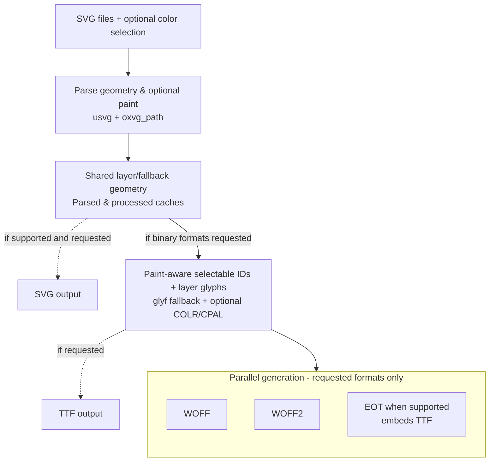
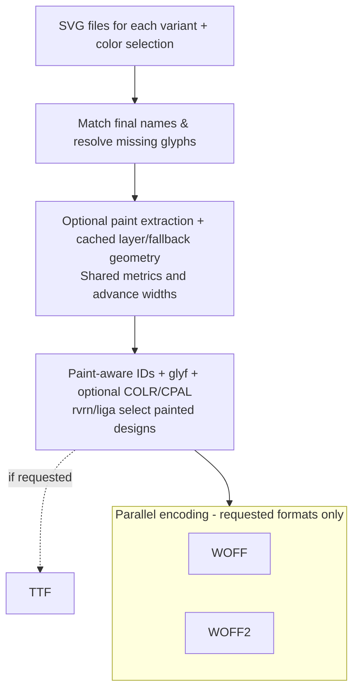

# Under the Hood

This page explains how the engine works internally. You don't need it to use any of the packages; see the [overview](./) for that.

## Adapters

The shared Rust engine owns font generation, template rendering, and caches. Each distribution is a thin adapter around it:

- The **npm package** owns the JavaScript API, callback transport, and conversion between JavaScript and Rust values. Its `webfont-generator-napi` crate is an internal workspace implementation, not a separate package for consumers to install.
- The **browser package** compiles the engine's filesystem-free API to WebAssembly with wasm-bindgen and runs it in a dedicated module worker.
- The **CLI** is a binary inside the Rust crate, behind the `cli` feature.

## Architecture

Owning the full pipeline made a new parallel architecture possible. The engine parses and normalizes glyphs once, then shares their prepared geometry between SVG output and binary font compilation. SVG serialization and font-table compilation can run in parallel, followed by parallel WOFF, WOFF2, and EOT generation. WOFF and WOFF2 consume the compiled tables directly, avoiding an intermediate TTF serialization and reparse. Together with parallel glyph processing, this reduces repeated work and makes better use of multiple CPU cores.

### Single-face fonts

For a single-face font, the generation pipeline works as follows:

1. **SVG loading** -- Read and validate source SVG files in parallel
2. **Glyph preparation** -- Parse glyph paths and optional solid paint with `usvg`, process geometry with `oxvg_path`, and normalize shared layer/fallback geometry. Parsed and processed caches retain paint for selected glyphs.
3. **Parallel SVG and table assembly** -- Serialize the SVG font if requested and supported by the selected options. Compile paint-aware selectable glyphs and auxiliary layers into shared tables using [`write-fonts`](https://github.com/googlefonts/fontations): `glyf` fallback plus COLR/CPAL for selected glyphs.
4. **Requested binary outputs** -- Assemble TTF if requested; generate WOFF and WOFF2 from shared tables, and EOT (which embeds TTF) when supported by the selected options.
5. **Template rendering** -- Render CSS and HTML previews via Handlebars when writing those files or calling the result's rendering methods

### Multi-variant fonts

For a family such as light, regular, and bold, the engine combines the designs into **one font file per requested format**:

1. **Family assembly** -- Load each variant's SVGs, match icons by name, assign shared codepoints, and apply the missing-glyph policy.
2. **Shared glyph preparation** -- Extract optional paint for selected logical names in every resolved variant. Cache shared layer/fallback geometry, normalized using family-wide metrics and shared advance widths.
3. **Variant compilation** -- Allocate paint-aware selectable IDs and auxiliary layer glyphs. Emit weight-axis metadata, `glyf` fallback, and optional COLR/CPAL tables. `rvrn` and conditioned `liga` select a painted design while retaining the shared advance; outlines are not interpolated.
4. **Output and templates** -- Assemble TTF if requested, encode requested WOFF and WOFF2 outputs in parallel, and render CSS/HTML with variant metadata and modifier classes.

This path supports TTF, WOFF, and WOFF2; SVG/EOT output is available only for color-disabled single-face fonts. Multi-variant families also support incremental regeneration, reusing cached geometry and paint for unchanged designs. See [multi-variant fonts](./node#multi-variant-fonts) and [color selection](./node#color-selection) for usage.

## Performance

The legacy `@vusion/webfonts-generator` engine does not support SVG path optimization. The Rust engine adds it through [`optimizeOutput`](./node#optimizeoutput). The tables compare Vusion with the native Node.js adapter's default settings and with path optimization enabled; enabling optimization performs extra work, so it need not be faster than leaving it disabled.

### Wall time on macOS

The following simple-icons workloads generate all five formats (SVG, TTF, EOT, WOFF, WOFF2), WOFF2 only, or WOFF + WOFF2. Values are milliseconds:

| Formats      | Glyphs | Vusion |                                 Native default |                  Native with path optimization |
| ------------ | -----: | -----: | ---------------------------------------------: | ---------------------------------------------: |
| All five     |    100 |   70.2 | <strong class="benchmark-winner">12.2</strong> |                                           12.7 |
| All five     |    300 |  259.6 | <strong class="benchmark-winner">40.3</strong> |                                           41.8 |
| All five     |    600 |  552.2 | <strong class="benchmark-winner">75.6</strong> |                                           80.7 |
| WOFF2        |    100 |   67.7 |                                           12.4 | <strong class="benchmark-winner">12.2</strong> |
| WOFF2        |    300 |  256.7 | <strong class="benchmark-winner">40.1</strong> |                                           41.4 |
| WOFF2        |    600 |  538.8 | <strong class="benchmark-winner">75.3</strong> |                                           78.8 |
| WOFF + WOFF2 |    100 |   69.9 | <strong class="benchmark-winner">11.8</strong> |                                           12.2 |
| WOFF + WOFF2 |    300 |  266.5 | <strong class="benchmark-winner">39.8</strong> |                                           42.5 |
| WOFF + WOFF2 |    600 |  545.2 | <strong class="benchmark-winner">74.3</strong> |                                           77.9 |

Across these nine workloads, the geometric mean speedup over Vusion is **6.5× with default settings** and **6.2× with path optimization enabled**.

### Wall time on Linux

The same workloads and Node.js API, using a Linux release addon in Docker:

| Formats      | Glyphs | Vusion |                                 Native default | Native with path optimization |
| ------------ | -----: | -----: | ---------------------------------------------: | ----------------------------: |
| All five     |    100 |   87.4 | <strong class="benchmark-winner">12.9</strong> |                          13.9 |
| All five     |    300 |  318.5 | <strong class="benchmark-winner">42.2</strong> |                          46.7 |
| All five     |    600 |  660.2 | <strong class="benchmark-winner">80.1</strong> |                          83.0 |
| WOFF2        |    100 |   84.1 | <strong class="benchmark-winner">12.6</strong> |                          13.4 |
| WOFF2        |    300 |  324.2 | <strong class="benchmark-winner">41.5</strong> |                          45.5 |
| WOFF2        |    600 |  637.9 | <strong class="benchmark-winner">77.8</strong> |                          82.9 |
| WOFF + WOFF2 |    100 |   87.8 | <strong class="benchmark-winner">12.8</strong> |                          13.9 |
| WOFF + WOFF2 |    300 |  331.8 | <strong class="benchmark-winner">42.2</strong> |                          46.2 |
| WOFF + WOFF2 |    600 |  675.6 | <strong class="benchmark-winner">77.8</strong> |                          87.4 |

The geometric mean speedup is **7.6× with default settings** and **7.0× with path optimization enabled**.

Modern-format builds skip SVG font serialization and TTF binary assembly in the Rust engine. Their total times remain close to the all-format builds here: fewer output formats do not necessarily translate into a large reduction in elapsed time.

### Peak memory usage

In separate cold, non-incremental runs, the native adapter used **about 90–92% less peak RSS on macOS** and **78–85% less on Linux** across the measured default/optimized settings. RSS includes Node.js, dependency loading, native allocations, and allocator-retained pages—not just the JavaScript heap or generated fonts. Values below are mean process peaks in MiB for 600 glyphs:

| Platform | Corpus       | Formats     |  Vusion |                                  Native default |                  Native with path optimization |
| -------- | ------------ | ----------- | ------: | ----------------------------------------------: | ---------------------------------------------: |
| macOS    | simple-icons | TTF         |   902.4 |  <strong class="benchmark-winner">76.1</strong> |                                           76.5 |
| macOS    | simple-icons | TTF + WOFF2 |   955.7 |                                            86.2 | <strong class="benchmark-winner">85.9</strong> |
| macOS    | logos        | TTF         | 1,052.7 |  <strong class="benchmark-winner">85.1</strong> |                                           89.5 |
| macOS    | logos        | TTF + WOFF2 | 1,113.5 | <strong class="benchmark-winner">108.5</strong> |                                          112.9 |
| Linux    | simple-icons | TTF         |   423.0 |  <strong class="benchmark-winner">69.9</strong> |                                           71.3 |
| Linux    | simple-icons | TTF + WOFF2 |   525.7 |  <strong class="benchmark-winner">78.3</strong> |                                           79.2 |
| Linux    | logos        | TTF         |   511.7 |  <strong class="benchmark-winner">80.8</strong> |                                           86.2 |
| Linux    | logos        | TTF + WOFF2 |   481.0 | <strong class="benchmark-winner">100.4</strong> |                                          106.9 |

Vusion's peaks varied substantially: macOS simple-icons TTF ranged from 590 to 1,034 MiB, and Linux logos TTF + WOFF2 from 349 to 567 MiB. Every measured Vusion peak exceeded the corresponding native workload's peaks, but these percentages are not universal memory guarantees.

### Measurement method

These measurements were refreshed on October 20, 2026, using Node.js 26.11.1, Vusion 0.8.0, native 0.10.0 release builds. Each platform ran 234 fresh Node processes sequentially: six rounds covering every ordering of Vusion, native default, and native with path optimization. All samples were retained. Native generation used 16 Rayon threads, with incremental caching and output-file writes disabled.

- **Wall time:** simple-icons 1.2.100, 100/300/600 glyphs, using the fixture naming and viewbox variation in `tests/webfonts-generator.bench.ts`. Each process warmed up once, then measured three generations; tables report the mean of six process medians. Dependency imports and output checks were outside timing. CSS/HTML options kept their API defaults.
- **RSS:** six fresh processes per implementation/setting/workload, one cold generation each, no warmup or forced garbage collection. Inputs were the first 600 sorted glyphs from simple-icons 1.2.100 or logos 1.2.16, with corpus glyph names and deterministically varied viewboxes. CSS and HTML were disabled. Peaks came from `process.resourceUsage().maxRSS` and include dependency loading.
- **Environment:** macOS arm64 and Linux arm64 (Debian bookworm/glibc 2.36 under OrbStack). Linux containers had 8 CPUs, an 8 GiB memory limit, and no additional swap. No builds or test suites ran alongside these measurements.

Both platforms loaded `ttf2woff2` 4.0.5's JavaScript fallback rather than its native addon; installations with a working native addon may behave differently. Vusion loads that dependency even for TTF-only output.

### Avoiding repeated work

The shared-geometry pipeline avoids reparsing an SVG font to compile binary formats. Requesting only the formats you need also skips unnecessary output work: a WOFF2-only build does not serialize an SVG font or assemble a TTF binary.

For repeated builds—such as a dev server regenerating your icon font whenever you edit an SVG—[incremental generation](./node#incremental) can reuse parsed glyphs, compiled glyphs, font tables, and WOFF compression or transform work from the previous build, giving you faster feedback while developing. In our 100–600-glyph benchmarks, a one-SVG edit rebuilt **1.5–1.8× faster than a full Rust build** and **12–17× faster than Vusion**, which always rebuilds the entire font.

Multi-weight families use a variant compilation path to produce TTF, WOFF, and WOFF2; see [multi-variant fonts](./node#multi-variant-fonts).

