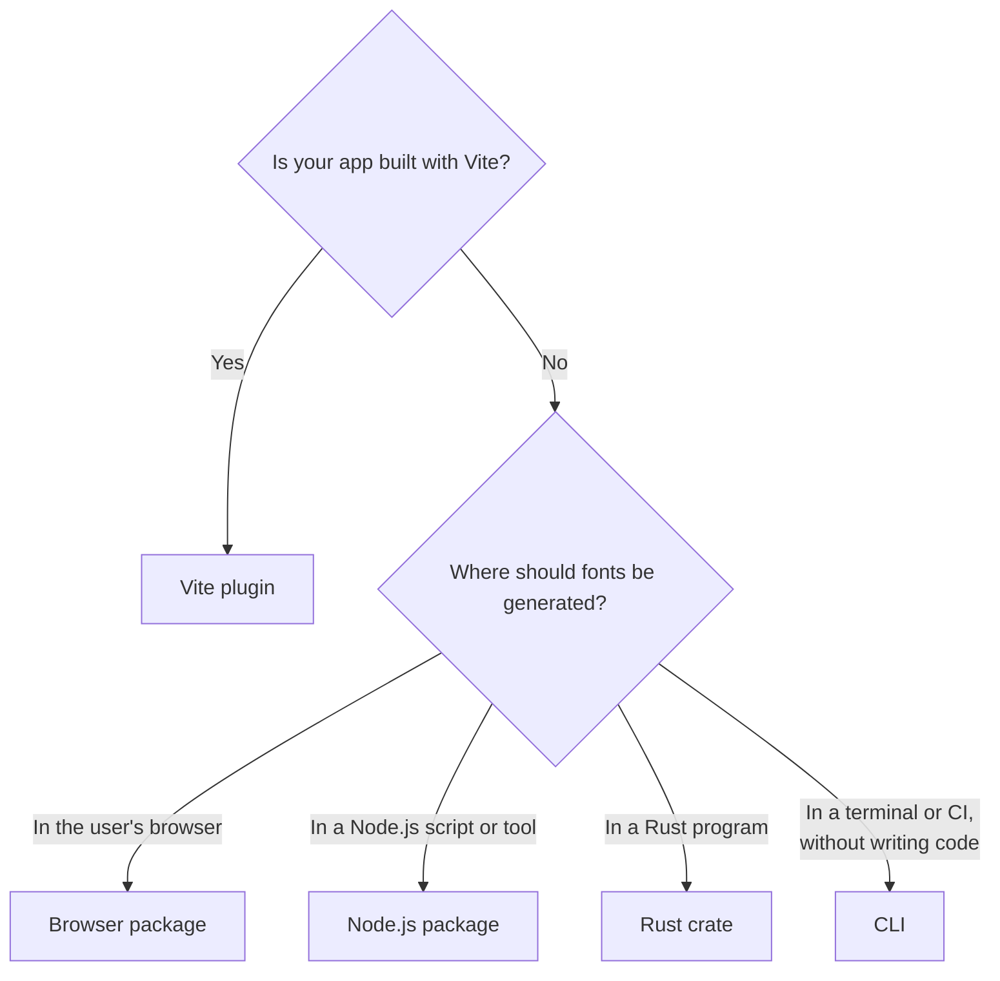

# Which Package Do I Need?

Every package here runs the same Rust engine, so the fonts they produce are the same. They differ in where they run and how you feed them icons.

## At a glance

| Package                                                               | Pick it when                                                                     | Input                                | Output                                                                    |
| --------------------------------------------------------------------- | -------------------------------------------------------------------------------- | ------------------------------------ | ------------------------------------------------------------------------- |
| [`vite-svg-2-webfont`](/getting-started)                              | Your app uses Vite and the icons live in your repository                         | A folder of SVG files                | A virtual CSS module and bundled font assets, updated live in development |
| [`@atlowchemi/webfont-generator`](/webfont-generator/node)            | You need fonts from a Node.js build script, another bundler, or your own tooling | SVG file paths                       | Font bytes and CSS/HTML in memory, optionally written to disk             |
| [`@atlowchemi/webfont-browser-generator`](/webfont-generator/browser) | Users create fonts in your web app, such as an icon editor or a font builder     | SVG text                             | Font bytes and CSS/HTML in memory                                         |
| [`webfont-generator` crate](/webfont-generator/rust)                  | You are writing Rust, or want generation without a Node.js runtime               | SVG file paths or SVG text           | Font bytes and CSS/HTML in memory, optionally written to disk             |
| [`webfont-generator` CLI](/webfont-generator/cli)                     | You want fonts from a shell script or CI job, or for a non-JavaScript project    | SVG files, folders, or a JSON config | Files on disk                                                             |

## What each one supports

| Feature                                           | Vite plugin              | Node.js         | Browser            | Rust               | CLI              |
| ------------------------------------------------- | ------------------------ | --------------- | ------------------ | ------------------ | ---------------- |
| SVG, TTF, EOT, WOFF, WOFF2                        | ✅                       | ✅              | ✅                 | ✅                 | ✅               |
| [Multi-weight families](/glossary#variant)        | ✅                       | ✅              | ✅                 | ✅                 | ✅ (JSON config) |
| [Color glyphs](/webfont-generator/#color-glyphs)  | ✅                       | ✅              | ✅                 | ✅                 | ✅ (JSON config) |
| Custom Handlebars templates                       | ✅ (file paths)          | ✅ (file paths) | ✅ (template text) | ✅ (paths or text) | ✅ (file paths)  |
| Callbacks (`rename`, `cssContext`, `htmlContext`) | `cssContext` only        | ✅              | —                  | ✅ (hooks)         | —                |
| Incremental rebuilds                              | Automatic in development | ✅              | ✅                 | ✅                 | —                |
| Live reload while editing SVGs                    | ✅                       | —               | —                  | —                  | —                |
| Preload tags in built HTML                        | ✅                       | —               | —                  | —                  | —                |
| Needs Node.js                                     | Yes                      | Yes             | No                 | No                 | No               |

The plugin calls the Node.js package internally, so plugin options map closely to [generator options](/webfont-generator/node#options-reference).

## Icon font or SVG sprite?

Icon fonts and SVG sprites (or inline SVGs) both put icons on a page, and they suit different needs. This project generates icon fonts, so here is a candid comparison to help you decide.

**An icon font is a good fit when:**

- **Icons sit next to text.** They inherit `color`, `font-size`, and `line-height`, and line up with the text baseline without extra CSS.
- **Your markup is just a class name.** `<i class="icon icon-add"></i>` works in any template, CMS, or third-party HTML where injecting SVG markup is awkward.
- **You want icons in CSS.** Glyphs work in `::before` and `::after` through `content`, which helps when you can't change the markup.
- **You want one cached file.** The browser downloads one small font, typically a few kilobytes as WOFF2, and caches it for every page.
- **You need several weights.** A [multi-weight family](/usage#multi-weight-icon-families) switches designs with a class, without loading another file.
- **You want ligatures.** Typing `search` inside an icon element can render the search glyph.

**An SVG sprite or inline SVG is a better fit when:**

- **Icons need full SVG artwork.** Gradients, strokes, masks, and many colors come out exactly as drawn. Icon fonts are monochrome by default, and [color glyphs](/webfont-generator/#color-glyphs) support only solid fills. Some platforms show the monochrome fallback instead.
- **You animate parts of an icon.** Separate SVG paths can be animated on their own; a font glyph cannot.
- **Icons must appear before any font loads.** Inline SVG renders with the HTML. An icon font renders once the font has loaded, though a [preload](/configuration#preloadformats) or [`inline`](/configuration#inline) shortens or removes that gap.
- **You use only a handful of icons from a large set.** Sprite tools can include only the icons a page uses. An icon font contains every icon it was built with, so build it from the set you actually use.

Many projects mix both: an icon font for the everyday UI icon set, and inline SVG for a few illustrations or brand marks.

## Next steps

- [Getting Started](/getting-started) with the Vite plugin
- [Webfont Generator overview](/webfont-generator/) for the engine packages
- [SVG authoring & troubleshooting](/svg-authoring) to prepare icons for any package
